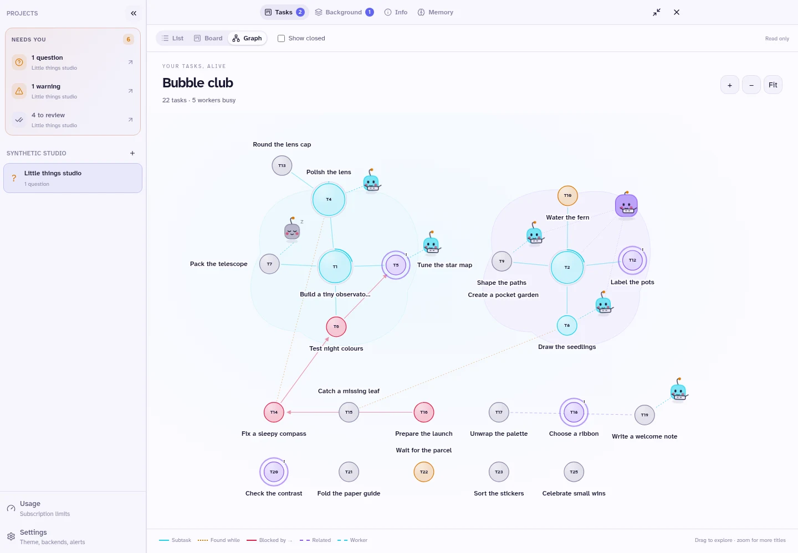
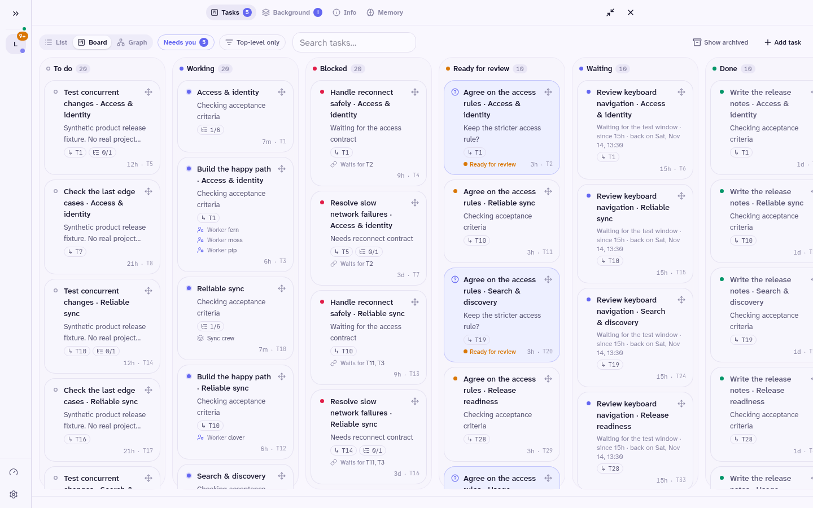

<p align="center">
  
</p>

<h1 align="center">Aiki</h1>

Aiki is a personal AI workbench: one coordinator delegates to background agents and brings questions and results back to you. [aikilabs.dev](https://aikilabs.dev)

<picture>
  <source media="(prefers-color-scheme: dark)" srcset="docs/assets/readme/graph-dark.webp" />
  
</picture>

*Real app, [synthetic demo](docs/assets/readme/README.md).*

## Why Aiki?

- **Delegate work.** Give the coordinator a goal; choose models from your own providers.
- **See what needs you.** Tasks, questions and reviews share a list, board or graph.
- **Come back later.** Runs resume after backend restarts; reports and artifacts stay with tasks.

## Try Aiki

[First pilot: `v0.1.0-pilot.1`](https://github.com/MitzaCoder/aiki/releases/tag/v0.1.0-pilot.1). Linux tested; macOS/WSL experimental; no phone push.

```sh
curl -fL https://github.com/MitzaCoder/aiki/releases/download/v0.1.0-pilot.1/install.sh -o install.sh
# Review install.sh before running it.
sh install.sh --version v0.1.0-pilot.1 --no-service
aiki start
```

Alternative download: `curl -fL https://aikilabs.dev/install.sh -o install.sh`, then the same review/run steps. This small [bootstrap](site/install.sh) verifies the versioned GitHub release installer before running it. Keep `--version`: GitHub's latest release excludes prereleases. Verify direct downloads with the release checksums. You need git; install jj for isolated workers. The installer supplies private Bun and zellij.

In another terminal:

```sh
aiki open
aiki pair
```

Open the private pairing URL in the same browser. Then connect a provider, choose a project folder and pick a coordinator model.

[Download the signed Android APK](https://github.com/MitzaCoder/aiki/releases/download/v0.1.0-pilot.1/aiki-v0.1.0-pilot.1-android-universal.apk) (Android 12+). Your phone needs your backend reachable over HTTPS; the APK is not a tunnel.

### Install with your coding agent

> Install Aiki from https://github.com/MitzaCoder/aiki. Follow docs/AGENT-INSTALL.md exactly and stop where it says to ask me.

The [agent guide](docs/AGENT-INSTALL.md) covers checks, sign-in boundaries and a source fallback.

## Board view

<picture>
  <source media="(prefers-color-scheme: dark)" srcset="docs/assets/readme/board-dark.webp" />
  
</picture>

Aiki runs commands with **your permissions** and provider spending authority. Every paired device has full owner access. This is not a sandbox or multi-user service. Keep the backend private.

Built on [pi durable](https://github.com/earendil-works/pi/tree/main/packages/durable). Original code: [MIT](LICENSE); dependencies keep their own licences.

[Install guide](docs/INSTALL.md) · [Pilot notes](docs/releases/v0.1.0-pilot.1.md) · [Design](docs/DESIGN.md) · [Operations](docs/OPERATIONS.md) · [Issues](https://github.com/MitzaCoder/aiki/issues)
